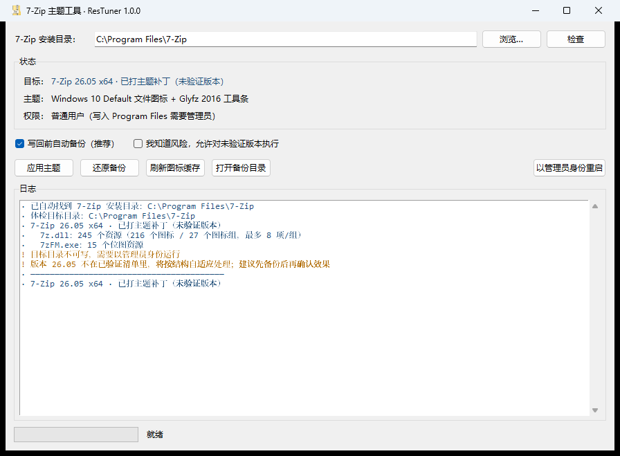

# ResTuner

> One-click theme patcher for 7-Zip — swap in Windows 10 style file icons and the Glyfz 2016 toolbar, then forget about it.

**Zero third-party dependencies**: pure Python standard library (`tkinter` / `struct` / `hashlib` / `winreg`). Python 3.9+.

:earth_asia: [English](./README.md) | [中文](./README_cn.md)

This tool is part of the [7zip-Theme](https://github.com/RipplePiam/7zip-Theme) repository, under `ResTuner/`.
The acceptance baseline reuses the parent repo's `patches/7z2501-x64-patch/` (byte-identical to
`assets/7z2501-x64-patch/`, so it is not duplicated here).



---

## What it does

7-Zip's "retro" look lives entirely in PE resources:

| File | Resource | Effect |
|---|---|---|
| `7z.dll` | `RT_ICON` + `RT_GROUP_ICON` (27 formats) | file icons in Explorer (`.7z`, `.zip`, `.rar`, …) |
| `7zFM.exe` | `RT_BITMAP` #100–106 / #150–156 | the 7 toolbar buttons (large & small) |

So "re-skinning" is **resource replacement** — not a single line of code is patched.

The stock build ships only 32×32 / 16×16 icons at 8 bpp per format. This tool swaps in **8 sizes**
(256/64/48/40/32/24/20/16, 32 bpp, 256 stored as PNG) and replaces the toolbar bitmaps with 4 bpp theme assets.

> Full reverse-engineering notes: [docs/7z2501-补丁分析.md](docs/7z2501-补丁分析.md) (Chinese)

---

## Quick start

**Option 1 (recommended — no Python required)**: run `dist/ResTuner.exe` from the release package.
**Option 2 (Python 3.9+)**: double-click `run_gui.bat`, or `py -3 run_gui.py`.

Then:

1. Install official 7-Zip (x64) as usual.
2. Launch ResTuner — it auto-detects the install folder and shows the version plus "official build / already patched".
3. Click **Apply theme** → back up → patch → self-check → write back.
4. Refresh the icon cache when prompted. Explorer may need a restart before *existing* files show their new icons.

Writing into `C:\Program Files` requires admin rights — use **Restart as administrator** in the bottom-right corner.

---

## Safety design

| Mechanism | Detail |
|---|---|
| **Pre-write self-check** | Re-parses the output, compares resource key sets, verifies every replaced payload, and confirms all untouched resources stay byte-identical. Any failure aborts the write |
| **Temp file + atomic replace** | Writes `*.restuner-new`, replaces only after the check passes |
| **Automatic backup** | `<install dir>\.restuner-backup\<version>_<timestamp>\` with `manifest.json`; SHA-256 verified before restore |
| **One-click restore** | Hash-checked restore; the result is byte-identical to the original files |
| **Idempotent** | Detects an already-patched install and refuses to stack patches |
| **Minimal footprint** | `7zFM.exe` only needs same-size bitmap swaps → patched **in place**, section table untouched; only `7z.dll` gets its `.rsrc` rebuilt |
| **Skip, never half-patch** | A format with no asset keeps its official icon and is reported as SKIP |

---

## Following new 7-Zip releases

* The extension → icon-index map is read from the target file's **own `RT_STRING` table** (`7z:0 zip:1 …`),
  so formats added in a future 7-Zip version are picked up automatically — as long as `assets/filetype` has a matching `.ico`
* Toolbar bitmaps are located by resource ID (100–106 / 150–156), with dimension and bit-depth validation
* The built-in verified-version list currently covers `25.01` and `26.05`, each with a **structure fingerprint**
  (icon-group count / icon count / type-table SHA-1 / toolbar bitmap ID set).
  Same version but a different structure → downgraded to "fingerprint mismatch", which still needs explicit confirmation.
  Completely unknown versions are simply "unverified". See [docs/26.05-复核.md](docs/26.05-复核.md) (Chinese) for how 26.05 was validated
* Every change is reported per item: applied / skipped / warning

---

## Layout

```
ResTuner/
├─ README.md / README_cn.md       English / Chinese docs
├─ run_gui.bat / run_gui.py       launchers
├─ assets/
│  ├─ filetype/*.ico              file type icons (8 sizes each)
│  ├─ toolbar/{24x24,48x36}/*.bmp toolbar bitmaps (4 bpp)
│  └─ 7z2501-x64/                 test input: official 25.01 build
│                                 (reference patch reused from ../patches/7z2501-x64-patch)
├─ src/restuner/
│  ├─ pe.py            PE header / section table / data directories / RVA mapping
│  ├─ checksum.py      PE CheckSum (matches CheckSumMappedFile)
│  ├─ rsrc.py          resource tree parsing + `.rsrc` rebuild + write-back strategy
│  ├─ icon.py          `.ico` → RT_ICON / GRPICONDIR (dimensions derived from image data)
│  ├─ bmp.py           `.bmp` header stripping + compatibility checks
│  ├─ theme.py         theme pack (asset dirs + alias table + bitmap ID table)
│  ├─ target.py        folder discovery / health check / version info / lock & permission
│  ├─ patcher.py       patch rules (7zFM in place, 7z.dll rebuild)
│  ├─ verify.py        self-check and resource-level diff
│  ├─ backup.py        backup / restore / verification
│  ├─ service.py       orchestration (inspect → patch → self-check → backup → write)
│  ├─ logbus.py        thread-safe logging
│  └─ gui/app.py       tkinter UI
├─ tests/             unit + acceptance tests (unittest)
├─ tools/
│  ├─ verify_parity.py resource-level acceptance against the reference patch
│  ├─ smoke_test.py    Windows smoke test (LoadLibrary / `7z.exe i` / icon decoding)
│  └─ dump_res.py      resource tree dumper
├─ packaging/
│  ├─ restuner.spec    PyInstaller config
│  ├─ version_info.txt Windows version resource
│  └─ build_exe.ps1    one-command build script
├─ dist/ResTuner.exe   the built single-file exe (git-ignored)
└─ docs/               analysis, design and release notes (Chinese)
```

---

## Packaging into a single exe

A build is included at `dist/ResTuner.exe` — about 11.5 MB, self-contained, no Python needed on the target machine.
`dist/` is git-ignored on purpose: the exe is published as a GitHub Release asset.

Rebuild it with:

```bat
py -3 -m pip install pyinstaller
powershell -ExecutionPolicy Bypass -File packaging\build_exe.ps1
```

or directly:

```bat
py -3 -m PyInstaller --noconfirm --clean --distpath dist --workpath build packaging\restuner.spec
```

The spec ([packaging/restuner.spec](packaging/restuner.spec)) is `console=False`, bundles only `assets/filetype`
and `assets/toolbar`, and takes its version resource from [packaging/version_info.txt](packaging/version_info.txt).

Runtime paths in the frozen exe (see `src/restuner/paths.py`):

| Purpose | Path |
|---|---|
| Bundled assets | PyInstaller extraction dir, `sys._MEIPASS\assets` |
| Logs | `%LOCALAPPDATA%\ResTuner\logs` (falls back to `%TEMP%`, then `<exe dir>\logs`; silently skipped if none is writable) |
| Backup | `.restuner-backup\` inside the target 7-Zip folder |

> **Note**: a PyInstaller onefile exe unpacks itself into `%TEMP%` on every start. If security software / an
> ASR policy blocks that, you will see `Failed to extract VCRUNTIME140.dll: ... Permission denied`.
> Add an exclusion for the exe, or build with `--onedir` (no runtime extraction).

---

## Development

```bat
:: run all tests
py -3 -m unittest discover -s tests -v

:: acceptance: output is resource-equivalent to the reference patch (except 3 known defects)
py -3 tools/verify_parity.py

:: smoke test: really loads and works under Windows
py -3 tools/smoke_test.py
```

The judgement in `tools/verify_parity.py` *is* the acceptance criterion. Compared with the parent repo's
`patches/7z2501-x64-patch`, **only** these three differences are allowed — all are defects in the
existing community patch that this tool deliberately does not reproduce:

1. `RT_GROUP_ICON #100` in `7zFM.exe`: the patch wrote the height as the width (110×63 → 110×110)
2. `RT_VERSION` in both files: the patch "recompiled" it and changed 4 bytes; this tool preserves it verbatim
3. `RT_GROUP_ICON 4` (arj) in `7z.dll`: the patch left two stale 8 bpp icons (11/12); this tool removes unreferenced icons

---

## FAQ

**Icons didn't change after patching?**
Explorer's icon cache is stubborn. Use **Refresh icon cache** in the UI, or end and restart `explorer.exe`; a sign-out may be needed.

**It says a file is in use?**
Close every 7-Zip window (including 7zFM in the tray), and any Explorer window currently browsing an archive.

**It says I have no write permission?**
`C:\Program Files` needs admin. Click **Restart as administrator**.

**Antivirus complains?**
The tool never touches the network or code sections — it only replaces PE resources and recomputes `CheckSum`.
That is still "modifying an executable", so whitelist it if needed.
If the target carries a digital signature, the signature is necessarily invalidated; the tool strips the
certificate table and says so in the log.

**32-bit or ARM64 support?**
x64 (`PE32+`) only. A non-x64 target is rejected outright — no broken output is ever produced.

---

## License

Theme assets belong to their respective authors (this repository, plus `RipplePiam/7zip-Theme`);
code is MIT. 7-Zip itself is © Igor Pavlov — this tool only edits resources of a local installation.
